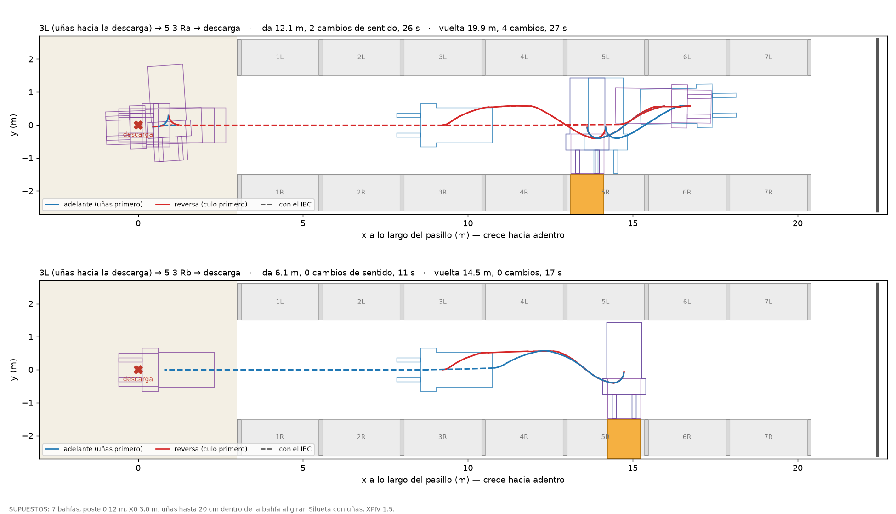

# Rutas entre bahías — resultados (05-nov-2026, en la i3)

Encargo: `tarea_rutas_bahias.md`. Código: `bahias.py` (direcciones `x y s`), `planificador_rutas.py`
(Hybrid A* con uñas). Todo sale de `py analisis/planificador_rutas.py` (~5 min en la i3), que escribe
`rutas_tabla.json` (lo lee la FSM) y `ruta_3L_5R.png`.

> **Rehecho el mismo 05-nov (tarea de visibilidad).** La primera versión **pegaba piezas con
> saltos escondidos**. El traslado cerraba con una recta sobre el rumbo que traía, con hasta 2–3°
> de error, y `unir()` arrancaba la pieza siguiente desde su pose exacta. Reproducidas de forma
> continua, las rutas llegaban corridas de 17 cm (mediana) a **1.28 m** (`barrido_7Lb`).
>
> **Ahora el traslado cierra exacto:**
> - una curva en S de dos arcos (Newton sobre la cinemática exacta) más una recta;
> - si la meta viene inclinada, un arco final en forma cerrada;
> - `unir()` falla si hay un salto, y cada ruta reporta `salto_max_m`. El máximo hoy es **8e-6 m**.
>
> **Los números de abajo son los nuevos.** Cambiaron poco en las idas, y más en las rutas que dan
> la vuelta en la zona: **la vuelta pasa a costar 3 cambios de sentido**. Lo que no cambió: el
> ancho a rumbo, la asimetría a/b, los controles y los barridos de XPIV y de profundidad.

```
py analisis/bahias.py                 # direcciones → pose objetivo y altura
py analisis/planificador_rutas.py     # casos 1–3, controles, barridos → rutas_tabla.json + la figura
py percepcion/sim_coordinacion.py     # la FSM, con tabla fija y con direcciones; termina en PASA/FALLA
```

## Lo que ordena todo: con uñas, ni el 90° ni el 180° caben en 3.00 m con todo dentro del pasillo

Lo que la silueta ocupa a lo ancho del pasillo **depende solo del rumbo**, no de dónde esté el
equipo: trasladarlo no lo cambia. Girar de 0° a 90° obliga a pasar por todos los rumbos del medio.

| Rumbo respecto del eje | 0° | 45° | 60° | 65° | **70–75°** | 80° | 85° | 90° |
|---|---|---|---|---|---|---|---|---|
| con uñas, vacío (m) | 1.32 | 2.69 | 2.96 | 3.01 | **3.03** | 3.01 | 2.97 | 2.90 |
| con uñas y el IBC (m) | 1.32 | 2.78 | 3.03 | 3.07 | **3.08** | 3.04 | 2.98 | 2.90 |
| sin uñas, chasis + patas (m) | 1.32 | 2.38 | 2.48 | 2.48 | 2.46 | 2.35 | 2.28 | 2.18 |

- **Con uñas el máximo es 3.036 m a 73°**. Con 5 cm de holgura por lado (2.90 útiles) **no cabe
  ningún rumbo entre 56° y 89.5°**. Con el IBC el máximo sube a **3.078 m** y la franja a 51–89.5°.
- Por lo tanto **ningún** giro de 90° (ni de 180°) existe con el equipo entero dentro del pasillo,
  por ningún camino. El Hybrid A* lo confirma por su cuenta: 0 de 10 carriles (control abajo).
- **El operador gira 90° todos los días. El modelo está incompleto, no la máquina.** Lo que falta
  modelar es la bahía: **al girar, las uñas (y el cubo) pasan la cara del rack**, dentro de la luz
  de la bahía a la que se entra o de la que se sale. El chasis nunca. `sec/gen_svg.py` ya dibujaba
  «uñas N cm dentro de la bahía al girar» con el modelo viejo.
- Cuánto pasan es **`PROF_BAHIA`, SUPUESTO = 0.20 m**. Por geometría hacen falta al menos 8.6 cm
  vacío y 12.8 cm cargado. Por búsqueda: **con 10 cm no gira nada, desde 15 cm sí** (tabla abajo).

**Lo que se mide para cerrarlo** (sin preguntarle a nadie): filmar desde arriba al operador
entrando a una bahía en N1 y en N3. Hay que ver **a qué altura van las uñas mientras gira**,
**cuánto pasan la cara** y **qué hay en la luz a esa altura**. Y medir el **radio del culo**: un
culo redondeado baja el ancho a rumbo. El modelo lo tiene en ángulo recto.

## Corregido (decía / es / qué lo tumbó)

| Decía | Es | Qué lo tumbó |
|---|---|---|
| «Girar cargado es igual que girar vacío» (`CLAUDE.md`, El giro) | **Solo para el chasis.** Con las uñas modeladas, el IBC (1.00 de ancho contra 0.73 de las uñas) suma **4 cm** al ancho a rumbo: 3.078 contra 3.036 | `ancho_a_rumbo()` con y sin `cargado` |
| El 180° no entra (chasis + uñas, 3.14 m a 75°), el 90° sí | **Los dos fallan dentro del pasillo**: es la misma franja de rumbos. Lo que separa al 90° del 180° es que el 90° termina en una bahía y usa su luz | el ancho a rumbo no depende del camino |
| La punta de uña a 8–15 cm de la cara, como `meta()` de `almacen-nuevo/` | **0–5 cm** (meta 3). De frente al rack, el equipo mide 2.90 de culo a punta y sobran **10 cm en total**; con 5 cm de holgura en el culo, a la punta le quedan 5 | `bahias.GAP_OBJ` |
| Solo chasis, peor caso 2.31 m | **2.48 m** con `L_ANCHO = 0.48` medido y las patas delante de la torre | la silueta del 318 con el dato del 18-sep |
| Las rutas compuestas son continuas (primera versión de este archivo) | **Tenían saltos escondidos entre piezas: hasta 1.28 m.** Ahora el cierre es exacto y el salto máximo es 8e-6 m | reproducir las primitivas de forma continua para la visibilidad: las llegadas no caían en el hueco. `saltos()` y el `assert` de `unir()` lo vigilan |
| Entrar a una bahía es lo mismo venga de donde venga | **Depende de la posición y del rumbo de viaje.** A la `a` (pegada al poste del lado de la descarga) solo se entra y se sale con las **uñas hacia adentro**; a la `b`, solo con las **uñas hacia la descarga**; por el **centro** de la bahía, en los dos sentidos | las uñas necesitan la luz a mitad del giro y el poste de al lado se la quita. Simétrico: la `b` es el espejo de la `a` |

## Caso 1 · el de maje: frente a 3L, uñas hacia la descarga; el cubo de 5R (N3) a la descarga



**¿Va de reversa?** **Sí.** Viene mirando a la descarga y el hueco está más adentro: hace el
traslado en reversa, con el culo primero. Lo que cambia todo es **cuál de los dos IBC de la 5R**.

| Hueco | Ida (vacío) | Vuelta a la descarga (con el IBC) | Total |
|---|---|---|---|
| **5 3 Rb** | **6.1 m · 0 cambios · 11 s**: un solo tramo en reversa; se corre al carril de giro (85 cm del rack L) y gira 90° metiendo las uñas a la 5R | **14.5 m · 0 cambios · 17 s**: sale girando con las uñas hacia la descarga y va de frente | **20.6 m · 28 s** |
| **5 3 Ra** | **12.1 m · 2 cambios · 26 s**: entra en reversa al **centro** de la 5R (8.2 m), sale de frente girando hacia adentro, y entra en reversa a la `a` | **19.9 m · 4 cambios · 27 s**: sale con las uñas hacia adentro (la `a` no deja otra), va en reversa hasta la zona, da la vuelta ahí (2 cambios) y llega de frente | **32.0 m · 52 s** |

Arriba van los vertical de la tabla de `CLAUDE.md`: ELEVA a 3.947 m, unos **7.2 s** a 0.55 m/s
(SUPUESTO). Después EXTIENDE, TOMA +6 cm, RETRAE y TRANSITO: bajar de 4.007 m, unos **7.3 s**.

**Lo que esto le dice a la FSM:** elegir `a` o `b` según el rumbo con que llega el equipo ahorra la
vuelta, que cuesta más que el traslado entero. **No está hecho.** Hoy el destino es el primer hueco
libre; la FSM paga la vuelta y la deja anotada en `maniobras`.

## Caso 2 · barrido: desde la descarga, uñas hacia adentro, a cada bahía

Pose de arranque (0, 0, 0°). Siete bahías por lado (SUPUESTO, del DXF). El lado L y el R dan lo mismo.

| Bahía | Llega a `a` | Llega a `b` | Sale de `a` | Sale de `b` |
|---|---|---|---|---|
| 1 | 4.5 m · 1 cambio · 8 s | 9.4 m · 3 · 17 s, **vuelta en la zona** | solo **al fondo** (1 cambio) | solo **a la descarga** (0) |
| 2 | 11.3 · 1 · 16 s | 10.2 · 3 · 18 s, vuelta en la zona | solo al fondo (0) | solo a la descarga (0) |
| 3 | 13.8 · 1 · 17 s | 12.7 · 3 · 19 s, vuelta en la zona | ídem | ídem |
| 4 | 16.1 · 1 · 19 s | 15.1 · 3 · 21 s, vuelta en la zona | ídem | ídem |
| 5 | 18.7 · 1 · 21 s | 17.6 · 3 · 23 s, vuelta en la zona | ídem | ídem |
| 6 | 21.2 · 1 · 23 s | 20.1 · 3 · 25 s, vuelta en la zona | ídem | ídem |
| 7 | 23.7 · 1 · 24 s | 22.5 · 3 · 26 s, vuelta en la zona | ídem | ídem |

Las 28 llegan. Las salidas de la `a` hacia la descarga y de la `b` hacia el fondo **no existen**
con `PROF_BAHIA = 0.20`. La vuelta en la zona cuesta **2 cambios de sentido** y unos **2–4 s** más
que ir directo a la `a` de la misma bahía.

## Caso 3 · el 180°

| | Resultado |
|---|---|
| 180° dentro del pasillo, **con uñas** | **no existe**: franja de 56–89.5° fuera de 2.90 m; la búsqueda agota 15 000 expansiones |
| 180° dentro del pasillo, sin uñas (control) | sí: 1.2 m, 1 cambio. El chasis solo cabe a todo rumbo (máx. 2.48 m) |
| **Dos 90° por el centro de una bahía** (`4 Lc`) | **sí: 7.8 m, 2 cambios, 18 s**. Entra en reversa con las uñas hacia adentro, sale de frente con las uñas hacia la descarga. Cambia el sentido de viaje sin 180° |

## Controles de falsación

| Control | Esperado | Dio |
|---|---|---|
| **Quitar las uñas** (giro de 90° desde el carril, meta vieja de `planificador_giro.py`) | volver a la ventana de solo chasis, 75–150 cm | **75–150 cm, todos con 0 cambios**; 70 cm choca al arrancar (patas a 2 cm). El viejo daba 1 cambio en 75 cm, con otra silueta de patas |
| Las mismas uñas, **sin bahía abierta** | ningún carril | **0 de 10** (la búsqueda coincide con la prueba de forma) |
| Con uñas **y** la bahía abierta | algún carril | **75–150 cm**, 0 cambios, a `4 La` y a `4 Lb` |
| **Pasillo de 2.80 m** | fallar o más cambios | **las 6 salidas fallan** (`4 La/Lb/Lc`, los dos rumbos) |
| FSM con rutas «sin rumbo» (a la `a` se entra de cualquier lado) | sin vuelta en el caso de maje | sin vuelta: la prueba 5 sí mira el rumbo |

## Barridos de lo que no está medido

**`XPIV`** (cambia el tope de dirección: 69.5° a 1.30, 84° a 1.60):

| XPIV | `a` sale adentro / descarga | `b` adentro / descarga | centro, los dos |
|---|---|---|---|
| 1.30 | 3 cambios / **no** | **no** / 3 cambios | 3 cambios |
| 1.40 | 1 / **no** | **no** / 1 | 1 |
| 1.50 | 0 / **no** | **no** / 0 | 0 |
| 1.60 | 0 / 1 | 1 / 0 | 0 |

La asimetría a/b se mantiene hasta 1.50. Con 1.60 desaparece, a costa de un cambio de sentido.
El 18-sep, solo chasis, «la forma domina al pivote». **Con uñas ya no**: el `XPIV` decide
cuántos cambios cuesta cada giro. Medirlo con plomada vuelve a ser necesario para planificar,
no solo para el control fino.

**`PROF_BAHIA`**: con 0.05 y 0.10 no sale nada. De 0.15 a 0.30, lo de la tabla de arriba. Con 0.40,
la `a` también sale hacia la descarga (1 cambio). **El resultado de la sección «Corregido» depende
de este número, que no está medido.**

## La FSM con direcciones (`percepcion/fsm_rutas.py`)

`py percepcion/sim_coordinacion.py` corre las 4 pruebas **dos veces**: con la tabla fija (los
números de `clases/fsm.html` no se movieron: deadlock en el tick 128, 62 tareas por corrida) y con
direcciones de bahía, donde las duraciones salen de `rutas_tabla.json`. Con direcciones también
pasan las cuatro: deadlock tardío en el tick 164, 19/20 en la operación al azar, tonto con choques en
19/20 y la buena en 0/0. La quinta es el caso de maje: las 22 etapas en orden, el cubo en la descarga,
la vuelta en la ida a la Ra y no a la Rb, y el tiempo de movimiento:

| | FSM | Planificador parando entre maniobras | Planificador sin parar |
|---|---|---|---|
| 5 3 Ra | 60 s | 54 s | 52 s |
| 5 3 Rb | 34 s | 31 s | 28 s |

La prueba 5 al principio **fallaba** (69 s y 40 s). Había dos causas:
1. **Un bug:** la RECTA volvía a contar los ~4 m que el CARRIL ya avanza mientras cambia de carril.
2. **Una comparación mal hecha:** la FSM termina cada paso quieta y se comparaba contra el plan
   continuo. Ahora se compara contra el planificador parado entre las mismas maniobras, con el
   mismo ±25 %, sin mover el umbral.

Lo que queda (+10 a +11 %) es redondeo a ticks y los pasos de 1 tick. **Parar entre pasos es lo que
cuesta la FSM por pasos:** hasta un 20 % contra el movimiento continuo.

## SUPUESTOS (todos parámetro)

| | Valor | De dónde |
|---|---|---|
| `N` bahías por lado | 7 | fila de 17.41 m del pasillo B en `datos/sectorA.json` (14 posiciones de piso) |
| `POSTE` | 0.12 m | el mismo DXF: 17.41 = 7 × 2.35 + 8 × 0.12 |
| `X0`, descarga → primer poste | 3.00 m | inventado |
| reparto de los 35 cm sobrantes | tres huelgos iguales | inventado |
| `PROF_BAHIA` | 0.20 m | inventado; ver la tabla |
| zona de descarga | 6 m de ancho, 3 m detrás del punto | inventado |
| `VEL_ELEV`, `VMAN`, `ACC` | 0.55 m/s, 0.35 m/s, 0.9 m/s² | `sim-web` |
| patas | 1.315 de ancho, 0.48 de largo **delante de la torre** | la del 318 con el `L_ANCHO` medido |
| `XPIV` | 1.50 | derivado (barrido arriba) |
| maniobras de la FSM | medidas vacío en la bahía 4, usadas para todas | `fsm_rutas.py` |

## Cómo está hecho, y por qué no es un solo A*

Es Hybrid A* (primitivas de 10 cm, 7 ángulos, dos sentidos, costo por cambio de sentido 1 m) con
**el mismo `step()`** de `planificador_giro.py` y `percepcion/odometria.py`, y la silueta muestreada
cada 5 cm.

Una sola búsqueda de 5 m de pasillo más un giro de pocos centímetros de huelgo **no salió en
80 000 expansiones** (un minuto en la i3). Por eso se compone, igual que maniobra el operador:
- **SALIDA:** de la bahía hasta quedar alineado.
- **ENTRADA:** es una salida invertida, y `step()` con punto medio es exactamente reversible.
- **TRASLADO:** cambio de carril más la recta.
- **VUELTA:** dos 90° por el centro de una bahía, o maniobra libre en la zona.

Cada combinación posible se evalúa y se elige la más barata. **No es óptimo globalmente:** es el
mejor de los planes armados con esas piezas.


## Dato de campo — el video del operador (maje, 05-nov-2026)

- Se pone en posición retrocediendo, y **una vez que empieza el giro no retrocede: solo mueve el
  timón**, de forma continua. Entra al mismo hueco al que se iba a alinear.
- Las uñas van a **pocos cm del piso** durante el giro (lo justo para no rozar). **No entran a los
  huecos del IBC** ni al girar ni al terminar, pero sí quedan **un poco dentro de la bahía**.
- El equipo queda **pegado a las dos bahías**: la de entrada y la de enfrente.
- **Los 3.00 m del pasillo se miden entre los postes de seguridad**, que son los puntos más
  angostos. Entre poste y poste, la cara de los cubos queda más atrás.

**Qué cambia en el modelo:** el pasillo no es una pared de 3.00 m. Son **postes cada 2.35 m** con
un **retranqueo entre postes, en los dos lados**, y las uñas (al piso) y posiblemente el culo
pueden usar ese retranqueo. `PROF_BAHIA` deja de ser un supuesto de "cuánto pasan la cara del
rack": es **la distancia del frente del poste al frente del cubo**, y se mide con cinta.

**Medir:** ancho y fondo de cada poste, su altura, la separación entre postes a lo largo del
pasillo, y el retranqueo del poste al frente del cubo a nivel del piso, en los dos racks.
