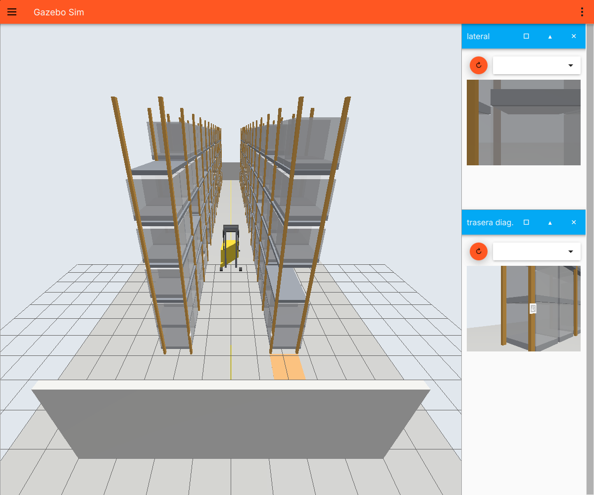
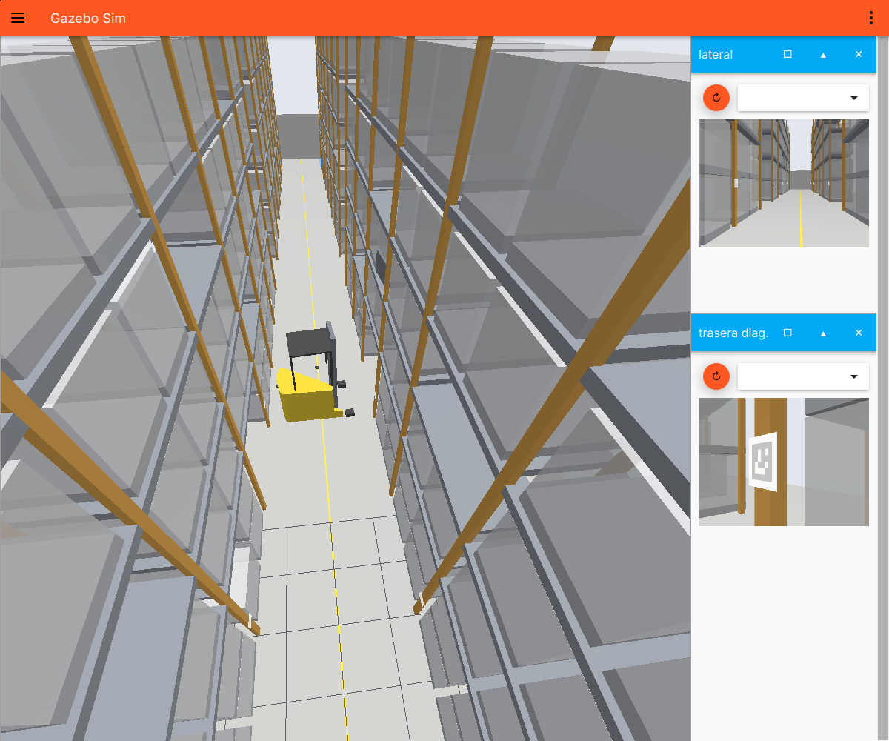

# sim-gazebo — el turno del EDR18N2 en 3D, con las llaves de localización (24-nov-2026)

El mismo turno de `sim/simulacion.html` (pasillo B del DXF, 4 pedidos, rutas v4 del planificador), en **Gazebo
Harmonic**, con:

- el pasillo, los racks con sus plataformas, cubos de relleno y las zonas de carga y descarga;
- **las 16 marcas ArUco** (DICT_4X4_50, 15 cm, a 1.0 m, cada 2 bahías en las dos caras), como texturas;
- el equipo con la **geometría v4**: entre ejes 1.688, rueda motriz **corrida 0.325 bajo el timón** (gira con δ),
  culo de la ficha, uñas de 1.20, carro con pantógrafo, inclinación (4° atrás al tomar) y desplazador;
- **las dos cámaras del montaje A2** (lateral izq. + trasera diagonal), **640×480, 54.3°** (la C920), a 1.0 m. Sus
  imágenes se ven en vivo en la ventana de Gazebo;
- un **fantasma azul**: dónde CREE el equipo que está.

**No es Isaac.** Gazebo corre en una gráfica común (superspeed con la RTX 4070, o lo que haya), y si no hay pantalla
corre igual sin ella. **Para dejarlo corriendo en superspeed: `ENCARGO_CAMPO.md`** (lo hace el Claude de campo desde la i3).

| | |
|---|---|
|  |  |
| la vista de arranque: el pasillo B desde el principio | «seguir al equipo», a los 45 s; a la derecha, las dos cámaras (la trasera ve una marca) |

`captura_cubo.png`: el equipo con el cubo en las uñas. Capturas del 24-nov, sin pantalla (render por software).

## Las llaves

En la consola (botón verde START, rojo STOP, como la de Botoni):

| ODOMETRÍA | ARUCO | Qué usa el equipo para saber dónde está |
|---|---|---|
| sí | sí | el EKF de `percepcion/ekf.py` con la odometría del bus y las marcas que ven las cámaras |
| sí | no | solo odometría: el EKF predice con lo que lee el bus |
| no | sí | solo ArUco: entre marca y marca predice con lo que se le **mandó** (no con lo que leyó) |
| no | no | **a ciegas**: hace el plan sin mirar nada (el fantasma es el plan) |

Se pueden cambiar en plena corrida.

## Qué pasa en cada modo (y por qué)

El equipo «de verdad» no hace exactamente lo que se le manda. Son supuestos razonables, en `nucleo.py`:

- **Errores que la odometría ve** (del actuador): la marcha da el 92 % de lo mandado y tarda 0.3 s; la rueda gira a
  50 °/s como mucho (medido el 23-nov) y el lazo para a ±0.5°.
- **Errores que la odometría no ve** (del sensor): el 0x184 lee la rueda 0.6° corrida (el centro se marcó a ojo) y el
  0x188 lee 1.5 % de más (la escala salió de 3.19 m de flexómetro).

El ejecutor sigue la ruta **por distancia**, no por reloj. Al final de cada tramo se arrima hasta donde CREE que
llegó, baja la marcha si la rueda va atrasada, y al llegar a la bahía corre el desplazador según lo que cree.

Resultado del turno completo, sin vista (`python3 sim-gazebo/nucleo.py --prueba`, 3 semillas, 24 llegadas a bahía):

| Modo | Uñas vs hueco, de lado (máx / mediana) | Fuera de ±4.5 cm | Cree vs real (máx) |
|---|---|---|---|
| a ciegas | 616 cm / 325 | 24 de 24 | — |
| solo odometría | 46 cm / 26 | 24 de 24 | 274 cm |
| solo ArUco | 24 cm / 1.6 | 9 de 24 | 109 cm |
| **odometría + ArUco** | **0.4 cm / 0.1** | **0 de 24** | **2 cm** |

- **Ninguna de las dos sola alcanza.**
  - La odometría deriva por los errores que no ve: 0.6° de rueda son metros al cabo del turno.
  - El ArUco solo se queda a ciegas donde no hay marcas a la vista (la alineación final, las zonas), y ahí predice con
    el mando, que tiene el error del 92 %.
- **Juntas:** el EKF estima el sesgo de la rueda y la escala de la velocidad mientras ve marcas, y llega corregido a los
  tramos ciegos.
- **Lo que sigue mal aun con las dos:**
  - **rumbo al llegar, hasta 2°**: en la alineación ninguna cámara ve marcas, como ya decía `visibilidad_v3.py`;
  - **roces de hasta ~4.5 cm** contra la cara al salir de la zona de descarga, donde casi no hay marcas cerca.
  Los dos señalan lo mismo: hace falta una tercera cámara o marcas en las zonas.

**Con Gazebo de verdad** (cámaras renderizadas, OpenCV, `solvePnP`), 24-nov:

| Prueba | Resultado |
|---|---|
| visión: el equipo puesto frente a las marcas (`--prueba-vision`) | 16 lecturas, error de pose **mediana 1.9 cm, máx 5.9**; rumbo 0.2° |
| el pedido 1 completo, odometría + ArUco (`--sin-gui --hasta 90`) | 456 lecturas aceptadas; cree vs real **1.5 cm**; uñas **0.2 cm** de lado; rumbo 3.2° |

## Instalar y correr

En **superspeed** (Ubuntu 22.04) o en un Ubuntu 24.04:

```bash
cd ~/tata && git pull origin main
./sim-gazebo/instalar.sh          # Gazebo Harmonic + gz-transport13 + OpenCV contrib (una vez, ~10 min)
./sim-gazebo/lanzar.sh            # genera el mundo y abre Gazebo 3D + la consola
```

`lanzar.sh` se corre **desde el escritorio** de la máquina, no por ssh. Por ssh, con la sesión gráfica abierta:
`DISPLAY=:0 ./sim-gazebo/lanzar.sh`.

- Gráfica vieja o WSL2 que se ve mal: `./sim-gazebo/lanzar.sh ogre`.
- Si va lento: `./sim-gazebo/lanzar.sh --liviano`. No procesa las imágenes: el ArUco sale de la geometría, con el ruido
  medido en la prueba de visión.
- **«seguir al equipo»** (consola) prende y apaga una cámara 3D que va 7 m detrás del equipo y 8 m arriba, sobre el eje
  del pasillo (`correr.py --seguir` arranca con ella). No es el seguimiento de Gazebo: ese gira con el equipo y al
  entrar a una bahía mete la cámara en el rack de enfrente. Con el ratón se puede mirar libre cuando está apagada.

Pruebas sin pantalla (lo que corre el Claude de campo para validar la instalación):

```bash
python3 sim-gazebo/nucleo.py --prueba                       # la lógica, sin Gazebo (~1 min)
python3 sim-gazebo/correr.py --prueba-vision                # Gazebo sin ventana: la cámara mide bien las marcas
python3 sim-gazebo/correr.py --sin-gui --modo ambos --hasta 90
```

## Archivos

| Archivo | Qué es |
|---|---|
| `generar_mundo.py` | lee `sim/sim_datos.json` y escribe `mundo/pasillo.sdf` y las texturas `mundo/aruco/*.png` |
| `nucleo.py` | la lógica sin Gazebo: plan, planta con sus errores, EKF, ejecutor, margen. `--prueba` |
| `correr.py` | Gazebo + visión (OpenCV) + consola. `--prueba-vision`, `--sin-gui`, `--aruco-geometrico` |
| `instalar.sh`, `lanzar.sh` | instalar y abrir. Buscan solos el Python que tiene los bindings de Gazebo (un venv activo no los ve) |
| `ENCARGO_CAMPO.md` | lo que corre el Claude de campo para dejarlo andando en superspeed |
| `mundo/` | lo que genera `generar_mundo.py` (se versiona: 300 kB) |

## Lo que NO hace (todavía)

- **Física de verdad.** El equipo se mueve con la cinemática del proyecto (`percepcion/odometria.py`). Gazebo dibuja y
  renderiza las cámaras; no simula patinar, ni la batería, ni la carga.
- **Los choques no frenan nada.** Se miden (margen a las caras, regla del Mundo v2/v3) y se avisan en rojo.
- **El LiDAR (Unitree L2) no está.** Se puede agregar como sensor `gpu_lidar` cuando toque.
- No re-planifica: si el equipo se va lejos, sigue intentando la misma ruta.
- Los errores de la planta son supuestos: los dos del sensor se cierran con la prueba de giros con tiza
  (`campo/giros_odometria/`).
